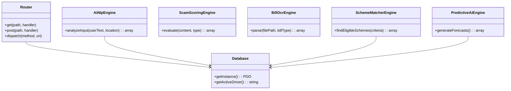
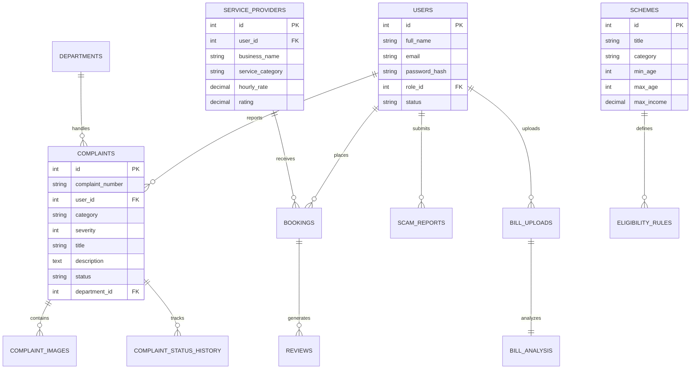
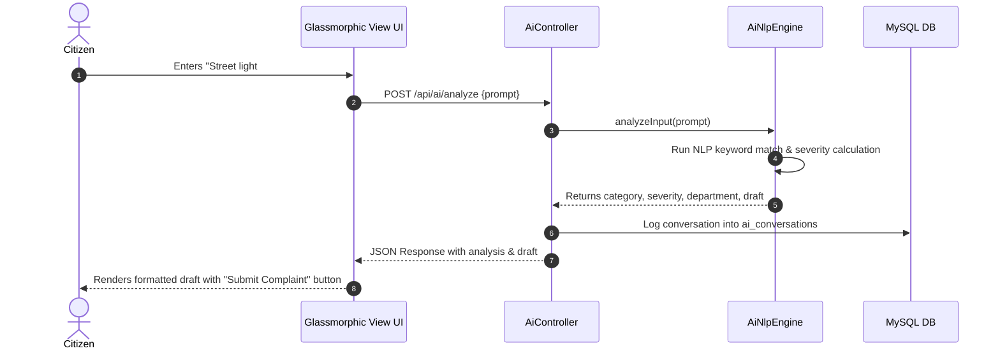
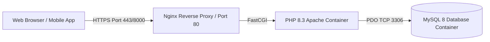

# CivicMind X - System Architecture Documentation

CivicMind X is designed around a lightweight, modular, Object-Oriented PHP 8.3 MVC framework. It decouples core business logic into domain services and provides clean RESTful API endpoints alongside server-rendered glassmorphic frontend views.

---

## 1. High-Level Architecture Diagram

```mermaid
graph TD
    User([Citizen / User]) -->|HTTPS / REST API| Router[Front Controller & Router]
    Provider([Service Provider]) -->|HTTPS / REST API| Router
    Officer([Municipal Officer]) -->|HTTPS / REST API| Router
    Admin([System Admin]) -->|HTTPS / REST API| Router

    subgraph Core Framework Layer
        Router --> Middleware[Middleware Pipeline (Auth, RBAC, CSRF)]
        Middleware --> Controllers[MVC Controllers Layer]
    end

    subgraph AI Engine & Business Services
        Controllers --> AiNLP[AI NLP Engine]
        Controllers --> ScamEngine[Scam Risk Scoring Engine]
        Controllers --> BillOCR[Bill OCR & Anomaly Engine]
        Controllers --> SchemeEngine[Scheme Eligibility Matcher]
        Controllers --> PredictiveAI[Predictive Civic Intelligence]
        Controllers --> TransEngine[Multilingual Engine]
        Controllers --> PdfEngine[PDF Report Generator]
    end

    subgraph Data & Storage Layer
        Controllers --> Models[Data Models PDO]
        Models --> MySQL[(MySQL 8 Database / SQLite Fallback)]
        Controllers --> Filesystem[(File Storage - Uploads & PDF)]
    end
```

---

## 2. Component Diagram



---

## 3. Entity-Relationship Diagram (ERD)



---

## 4. Sequence Diagram: AI Complaint Auto-Drafting Workflow



---

## 5. Deployment Architecture Diagram


